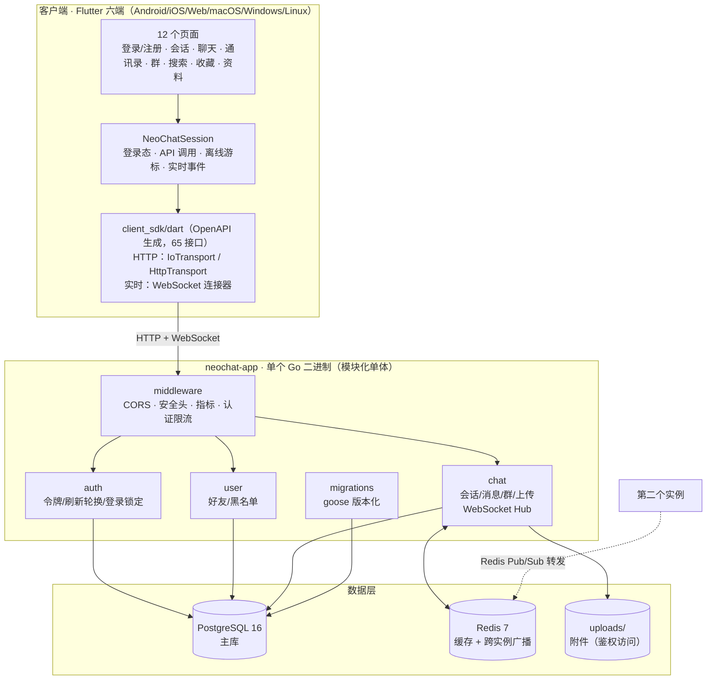

# NeoChat

跨平台即时通讯应用：Go 后端 + Flutter 客户端，支持 Android / iOS / Web / macOS / Windows / Linux 六端。

当前版本 **v0.1.0**（变更记录见 [CHANGELOG.md](CHANGELOG.md)，阶段结论见 [docs/ROADMAP.md](docs/ROADMAP.md)）。

## 当前状态

| 层 | 状态 |
|---|---|
| 后端 API | 65 个接口，OpenAPI 文档 + 契约测试 |
| 客户端 | 12 个页面：登录、注册、会话、聊天、通讯录、建群、群信息、搜索、@我的、收藏、我的资料、他人资料 |
| 实时 | WebSocket：新消息、正在输入、已读回执、在线状态、跨实例广播 |
| 消息 | 文本 / 图片 / 文件 / 语音 / 视频，引用回复、编辑、转发、撤回、收藏、历史分页 |
| 群聊 | 建群、拉人、设管理员、踢人、退群、解散、改群资料 |
| 关系 | 好友请求、好友列表、黑名单、免打扰、会话置顶 |
| 验证 | 端到端 30 步（SQLite + Postgres 双跑）、实时 8 步、跨实例双向广播、真实 Chrome 运行时、离线缓存 |

## 一张图看懂



渲染不了 mermaid 的地方看这个等价描述：

```
客户端（Flutter 六端）
  12 个页面 → NeoChatSession（唯一状态源）→ client_sdk/dart（65 接口）
  网络：HTTP + WebSocket，平台差异由 SDK 的条件导入收敛

后端（单个 Go 二进制）
  middleware（CORS/安全头/指标/限流）
    → auth（令牌、刷新轮换、登录锁定）
    → user（好友、黑名单）
    → chat（会话/消息/群/上传 + WebSocket Hub）
    → migrations（goose 版本化迁移）

数据层
  PostgreSQL（主库）· Redis（缓存 + 跨实例广播）· uploads/（附件，经鉴权接口访问）

多实例：实例 A 收到消息 → 本地投递 + Redis Pub/Sub → 实例 B 投递（带 Origin 标记防回环）
```

**一句话**：客户端只管界面与状态，协议由生成的 SDK 约束；后端是单二进制，
模块靠 Go 包边界而非网络调用；数据库与缓存都可替换（SQLite ↔ PostgreSQL，单机 ↔ 多实例）。

## 验证矩阵

| 层次 | 命令 | 覆盖 | 实测 |
|---|---|---|---|
| 后端单元/集成 | `cd backend && RUN_INTEGRATION_TESTS=true go test ./...` | 24 个测试文件：认证、聊天、缓存失效、迁移、限流 | ✅ 全绿 |
| 客户端单元 | `cd client_app && flutter test` | 25 个用例：会话状态、消息缓存、刷新、群/好友/置顶 | ✅ 25/25 |
| SDK | `cd client_sdk/dart && dart test` | Web 传输层（MockClient，无需浏览器） | ✅ 3/3 |
| 接口契约 | `cd backend && go test ./cmd/api-gateway/` | 路由是否注册、swagger 是否覆盖 | ✅ |
| 端到端（SQLite） | `bash scripts/e2e_local.sh` | 30 步 HTTP（86 断言）+ 7 步实时（8 断言） | ✅ 全通过 |
| 端到端（Postgres） | `bash scripts/e2e_postgres.sh` | 同一套断言跑在真 Postgres 上 | ✅ 全通过 |
| 端到端（容器） | `docker compose up -d` 后跑 E2E | 容器内的生产配置（PG + Redis + 非 root） | ✅ 全通过 |
| 跨实例广播 | `bash scripts/verify_multi_instance.sh` | 两实例双向 WebSocket 投递（真 Redis） | ✅ 双向通过 |
| Web 运行时 | `bash scripts/verify_web.sh start/check` | 真实 Chrome 挂载 + 浏览器 origin 全链路 | ✅ PASS |

细节与已知限制见 [docs/VERIFICATION.md](docs/VERIFICATION.md)。

## 技术栈

**后端**：Go 1.24、Gin、GORM、PostgreSQL（生产）/ SQLite（测试）、Redis（缓存 + 跨实例广播）、JWT、gorilla/websocket、swaggo

**客户端**：Flutter 3.44、Dart 3.12；状态用 `ChangeNotifier`（`NeoChatSession`），HTTP/WS 走自研 SDK，媒体播放用 `just_audio` / `video_player`，本地缓存用 `shared_preferences`

**代码生成**：`swag init` → `backend/docs/swagger.json` → `scripts/gen_dart_client.py` → `client_sdk/dart` → `client_app`

## 目录结构

```
backend/           Go 后端（cmd/api-gateway、internal/{auth,user,chat}、pkg/*）
backend/Dockerfile 多阶段构建，运行镜像非 root
client_sdk/dart/   由 OpenAPI 生成的 Dart SDK（含 realtime 与测试工具）
client_app/        Flutter 客户端
docs/              架构、安全、验证、迁移、API 说明
scripts/           E2E 与验证脚本
docker-compose.yml Postgres + Redis + 后端 一键起
```

## 快速开始（Docker）

```bash
cp .env.example .env
# 编辑 .env，至少把 NEOCHAT_JWT_SECRET 换成 32 位以上随机串

docker compose up -d --build
curl http://127.0.0.1:8080/health
```

起三个服务：`neochat-postgres`（15432）、`neochat-redis`（6379）、`neochat-app`（8080）。
上传文件持久化在命名卷 `neochat_uploads`，数据库在 `neochat_pgdata`。

> 国内网络：在 `.env` 里放开 `GO_IMAGE` / `RUNTIME_IMAGE` / `PG_IMAGE` / `REDIS_IMAGE`
> 的镜像源注释，并把 `GO_PROXY` 设为 `https://goproxy.cn,direct`。

停止并清理：

```bash
docker compose down          # 保留数据卷
docker compose down -v       # 连数据一起删
```

## 本地开发（SQLite，不需要任何中间件）

```bash
cd backend
go build -o /tmp/neochat ./cmd/api-gateway
cd /tmp && ./neochat          # 默认 8080，自动 SQLite 建库
```

客户端：

```bash
cd client_app
flutter pub get
flutter run -d macos          # 或 chrome / ios / android
# 指向其它后端：--dart-define=NEOCHAT_BASE_URL=http://127.0.0.1:8080
```

## 跑一遍验证

```bash
cd backend && RUN_INTEGRATION_TESTS=true go test ./...   # 后端
cd client_app && flutter analyze && flutter test          # 客户端
bash scripts/e2e_local.sh                                 # 端到端（SQLite）
```

其余层次见上面的[验证矩阵](#验证矩阵)与 [docs/VERIFICATION.md](docs/VERIFICATION.md)。

## 安全相关

- 访问令牌与刷新令牌类型隔离（`typ` 声明），刷新令牌一次性轮换、可吊销
- 登录失败 5 次锁定 15 分钟；认证接口按 IP 限流；生产环境弱 JWT 密钥拒绝启动
- 上传文件不再公开暴露：`GET /api/v1/files/*path` 需鉴权，被消息引用的文件还要求是会话成员
- 细节与上线检查清单见 [docs/SECURITY.md](docs/SECURITY.md)

## 文档

| 文档 | 内容 |
|---|---|
| [docs/README.md](docs/README.md) | 文档索引（按角色分类） |
| [docs/ROADMAP.md](docs/ROADMAP.md) | 阶段结论：已完成、待验证、不做什么 |
| [docs/MIGRATIONS.md](docs/MIGRATIONS.md) | 版本化迁移：目录结构、新增步骤、验证方式 |
| [docs/VERIFICATION.md](docs/VERIFICATION.md) | 五层验证体系与实测结果 |
| [docs/SECURITY.md](docs/SECURITY.md) | 令牌模型、防护机制、上线检查清单 |
| [docs/CLIENT-FEATURES.md](docs/CLIENT-FEATURES.md) | 客户端能力与交互速查 |
| `backend/docs/swagger.json` | OpenAPI 契约（启动后 `/swagger/index.html`） |
| [client_sdk/dart/README.md](client_sdk/dart/README.md) | SDK 用法、协议细节、响应结构约定 |

## 已知限制

- 无系统级推送通知（仅应用内提醒），需要 APNs/FCM 或平台通知插件
- 真机录音/播放未做自动化验证
- 迁移已版本化（goose），但回滚（Down）尚未在 CI 中演练
- 无压力测试结论

## License

见 [LICENSE](LICENSE)。
